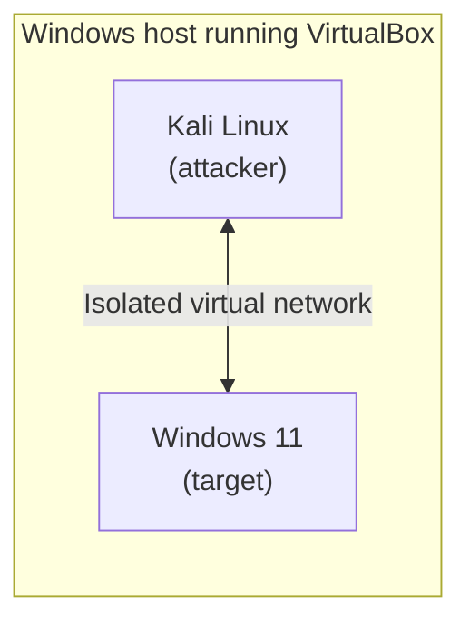

# Cybersecurity Home Labs

This repository documents the setup and configuration of a cybersecurity home lab using Oracle VirtualBox, Kali Linux, and Windows 11.

**Purpose:** To build a controlled virtual environment for hands-on cybersecurity practice, experimentation, and skill development.

> **Ethics and legal notice:** All activity in this lab takes place on virtual machines that I own, inside an isolated environment. I do not test systems or networks that I do not own or have written permission to test.

## Objectives

- Set up a virtual lab environment using VirtualBox.
- Install and configure Kali Linux and Windows 11.
- Learn virtual networking and isolate lab systems safely.
- Practice cybersecurity techniques in an authorized environment.
- Document troubleshooting, experiments, and lessons learned.

## Lab Environment

| Component | Details |
| --- | --- |
| Virtualization | Oracle VirtualBox 7.2.20 |
| Host Operating System | Windows (16 GB RAM) |
| Attacker Machine | Kali Linux 2026.2 |
| Target Machine | Windows 11 |
| Networking | Isolated virtual network (in progress) |

### Planned Lab Layout

## Documentation

Detailed setup procedures and troubleshooting notes are kept in separate files.

| # | Document | Status |
| --- | --- | --- |
| 1 | [VirtualBox Installation](01-VirtualBox-Installation.md) | Complete |
| 2 | [Kali Linux Installation](02-Kali-Linux-Installation.md) | Complete |
| 3 | [Windows 11 Installation](03-Windows-11-Installation.md) | Complete |
| 4 | [Lab Networking](04-Lab-Networking.md) | Complete |
| 5 | [Guest Additions and Snapshots](05-Lab-Basics-and-Snapshots.md) | Complete |

## Roadmap

- [x] Install VirtualBox
- [x] Install Kali Linux
- [x] Install Windows 11
- [x] Configure an isolated network between Kali and Windows 11
- [x] Verify connectivity between the machines
- [x] Prepare the lab: Guest Additions and clean snapshots
- [ ] Run a first network scan from Kali against Windows 11 and document the results
- [ ] Review the scan from the defender's side using Windows logs
